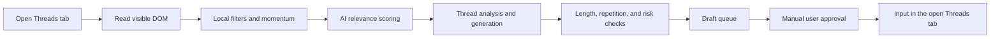

<div align="center">
  
</div>

# ThreadSense AI

> [!CAUTION]
> ## ⚠️ Important warning: Meta, automation, and account suspension
>
> **The author is not affiliated with Meta, Instagram, or Threads and accepts no liability for account suspension, data loss, AI API charges, or any other damage.** Automated access to or collection of data from Meta products is prohibited without Meta's prior express written permission. The Threads Terms separately prohibit robots, scrapers, and other automated means used to access, extract, or collect information. Using this extension may result in restrictions, temporary suspension, or permanent loss of your account.
>
> By installing ThreadSense AI, you assume the entire risk. Use only your own account and data, do not bypass protective mechanisms, and review the current [Threads Terms](https://help.instagram.com/769983657850450), [Instagram Terms](https://www.facebook.com/help/instagram/581066165581870), and [Meta Automated Data Collection Terms](https://www.facebook.com/legal/automated_data_collection_terms) before every use. Pace and delay settings **do not make automation permitted or “undetectable.”**

<div align="center">

### AI assistant for discovering conversations, drafting replies, and managing a review queue on Threads


[](https://github.com/sany86russ/ThreadSense-AI/stargazers)

**Finds relevant threads → scores them → drafts in your voice → sends the result to manual review.**

[⭐ GitHub](https://github.com/sany86russ/ThreadSense-AI) · [🚀 Quick start](#-quick-start) · [🧭 Interface](#-interface) · [⚙️ All settings](#️-all-settings) · [🤖 AI providers](#-ai-providers) · [❓ FAQ](#-frequently-asked-questions) · [💜 Support the author](#-support-the-author)

[Русский](README.md) · **English**

</div>

---

## 📑 Contents

- [What it is](#-what-it-is)
- [Features](#-features)
- [Interface](#-interface)
- [Requirements](#-requirements)
- [Installation](#-installation)
- [Quick start](#-quick-start)
- [Safe defaults](#-safe-defaults)
- [Work modes](#-work-modes)
- [AI providers](#-ai-providers)
- [All settings](#️-all-settings)
- [How the agent works](#-how-the-agent-works)
- [Data, keys, and privacy](#-data-keys-and-privacy)
- [Chrome permissions](#-chrome-permissions)
- [Diagnostics and troubleshooting](#-diagnostics-and-troubleshooting)
- [Development and tests](#-development-and-tests)
- [Project structure](#-project-structure)
- [Limitations](#-limitations)
- [Frequently asked questions](#-frequently-asked-questions)
- [Support the author](#-support-the-author)
- [Contributing](#-contributing)
- [Disclaimer and license](#️-disclaimer-and-license)

---

## 🧠 What it is

**ThreadSense AI** is an open-source Chrome extension that works with the visible Threads web interface. It helps discover conversations in your topic, filter and rank posts, analyze thread context, draft replies or original posts using a selected AI model, and place the result in an approval queue.

The project is designed for non-technical users too. First launch is split into four clear steps, advanced controls stay out of the way until requested, and settings save automatically.

> [!IMPORTANT]
> ThreadSense AI **does not use the official Threads API** and is not approved by Meta. It reads the DOM available to you in an open tab and interacts with normal page editors. This is a technical description, not a statement that such use is permitted.

## ✨ Features

| | What it does |
|---|---|
| 🎯 **Topic discovery** | Niche, languages, keywords, exclusions, search queries, topics, target authors, and blocked authors. |
| 🧮 **Multi-stage selection** | Free local filters, momentum detection, then scoring for relevance, freshness, engagement, opportunity, and risk. |
| ✦ **Pluggable AI** | OpenAI, Anthropic, DeepSeek, Kimi, Gemini, xAI, Mistral, Groq, OpenRouter, Together AI, or a custom OpenAI-compatible API. |
| 🔎 **Key-based model discovery** | The connection test fetches the models available to the key directly from the selected provider. |
| ✍️ **Your voice** | Manual voice profile, examples, favorite fillers and emoji, banned phrases, or training from your own profile. |
| 🧩 **Custom prompts** | Separate instructions for relevance, thread analysis, comments, audience replies, and original posts. |
| 🗂 **Draft queue** | Review, approve, reject, and inspect processed drafts before publication. |
| 🛡 **Guardrails** | Daily/hourly limits, warm-up, pauses, author cooldowns, circuit breakers, rechecks, and emergency halts. |
| 📊 **Clear control** | Status, daily progress, likes, views, estimated spend, history, and explicit stop reasons. |
| 🧰 **Diagnostics** | DOM selector inspection, post highlighting, generation dry run, and settings import/export. |

## 🧭 Interface

### Control center and settings

The main page shows setup readiness, four required steps, agent status, daily progress, and the recommended pace. Essential controls are immediately visible; technical parameters are grouped under Advanced settings.


### Compact extension popup

The popup is for everyday use: start or stop, change pace, see daily limits and the draft queue, inspect recent events, and jump to settings.

<p align="center">
  
</p>

## 📋 Requirements

- Google Chrome **116+** or a compatible Chromium browser with Manifest V3;
- an active Threads account and an open `threads.com` or `threads.net` tab;
- an API key from at least one supported AI provider;
- Node.js **20+** for development and tests;
- a clear understanding and personal acceptance of the risks stated at the top of this README.

## 📥 Installation

### Ready-to-use build — recommended

1. Download [`ThreadSense-AI-v2.2.0-unpacked.zip`](https://github.com/sany86russ/ThreadSense-AI/releases/download/v2.2.0/ThreadSense-AI-v2.2.0-unpacked.zip) from **Assets** on the [latest release](https://github.com/sany86russ/ThreadSense-AI/releases/latest).
2. Extract the ZIP to a permanent location. It contains a ready-to-use `ThreadSense-AI-v2.2.0` directory with `manifest.json` at its root.
3. Open `chrome://extensions`.
4. Enable **Developer mode**.
5. Select **Load unpacked**.
6. Choose the extracted `ThreadSense-AI-v2.2.0` directory — the one that directly contains `manifest.json`.
7. Pin ThreadSense AI to the browser toolbar.

> [!IMPORTANT]
> Chrome loads a **directory**, not the ZIP file. Extract the archive first. Do not move or delete the selected directory after installing the extension.

### Install from source

Developers can clone the repository and select its `extension` directory. After pulling updates, press **Reload** on the extension card at `chrome://extensions`.

```powershell
git clone https://github.com/sany86russ/ThreadSense-AI.git
cd ThreadSense-AI
```

> [!NOTE]
> The ready ZIP contains only extension files from tag `v2.2.0`: no tests, Git history, local settings, or keys. It is an unpacked Manifest V3 extension rather than a `.crx`; Chrome may display its standard Developer mode warning.

## 🚀 Quick start

### 1. Download and install the ready build

1. Open the [latest ThreadSense AI release](https://github.com/sany86russ/ThreadSense-AI/releases/latest).
2. Under **Assets**, download **`ThreadSense-AI-v2.2.0-unpacked.zip`**.
3. Extract it and remember the location of the `ThreadSense-AI-v2.2.0` directory.
4. Enter `chrome://extensions` in the Google Chrome address bar.
5. Enable **Developer mode** in the top-right corner.
6. Select **Load unpacked** and choose the `ThreadSense-AI-v2.2.0` directory containing `manifest.json`.
7. Select the puzzle icon in the Chrome toolbar and pin **ThreadSense AI**.

### 2. Connect AI

Open **Settings → AI connection**, select a provider, paste your own API key, and press **Test**. After a successful check, assign models for:

- post scoring;
- comment writing;
- voice analysis.

If you are unsure, use one available low-cost model in all three fields and leave the advanced parameters unchanged.

### 3. Add your profile and topic

Under **My topic**:

1. enter your Threads handle without `@`, or press **Detect**;
2. describe what you write about and which conversations matter in plain language;
3. add languages and several search queries;
4. optionally add excluded words and blocked authors.

A missing key, handle, or topic description is enough for the wizard to deliberately prevent startup.

### 4. Set your voice

Open **My style** and choose one route:

- press **Train** while your own Threads profile is open;
- describe your tone and writing habits manually;
- add several genuine examples of your comments.

### 5. Start cautiously

Keep the **Careful** preset and **Show me drafts first** enabled. Open Threads, press **Start**, and review every result in the queue.

> [!TIP]
> Before real use, open **Advanced settings → Diagnostics**, run the selector check, and then a generation dry run. The dry run consumes AI tokens but publishes nothing.

## 🔒 Safe defaults

A fresh install intentionally does nothing on its own:

- the agent is stopped;
- auto-publishing is disabled;
- original-post publishing is disabled;
- if original posts are enabled, `draftsOnly` initially keeps them as drafts;
- the slowest **Careful** preset is selected;
- the AI connection remains unverified until a real test succeeds;
- API key, handle, and niche are blank;
- importing a profile stops the agent and requires readiness checks again;
- migration from an older release resets risky modes and reopens onboarding.

This reduces accidental activation, but **does not override Meta's prohibitions or guarantee account safety**.

## 🎚 Work modes

A preset changes limits, intervals, selection breadth, and protective pauses as one consistent unit. It **does not enable auto-publishing or original posts**.

| Mode | Comments/day | Original posts/day* | Intended use |
|---|---:|---:|---|
| **Careful** | up to 8 | up to 2 | First launch, long breaks, gradual warm-up. |
| **Normal** | up to 14 | up to 4 | An established, fully configured profile. |
| **Intensive** | up to 20 | up to 4 | A warmed-up profile under constant manual supervision. |
| **Maximum** | up to 28 | up to 6 | The most aggressive profile; restriction risk is especially high. |

\* The original-post limit only applies after that feature is separately enabled. No mode is “ban-proof.”

## 🤖 AI providers

| Provider | Protocol | Default endpoint | Model discovery |
|---|---|---|---|
| OpenAI | Chat Completions | `https://api.openai.com/v1` | Yes |
| Anthropic | Messages API | `https://api.anthropic.com/v1` | Yes |
| DeepSeek | OpenAI-compatible | `https://api.deepseek.com/v1` | Yes |
| Kimi / Moonshot AI | OpenAI-compatible | `https://api.moonshot.ai/v1` | Yes |
| Google Gemini | Gemini API | `https://generativelanguage.googleapis.com/v1beta` | Yes |
| xAI / Grok | OpenAI-compatible | `https://api.x.ai/v1` | Yes |
| Mistral AI | OpenAI-compatible | `https://api.mistral.ai/v1` | Yes |
| Groq | OpenAI-compatible | `https://api.groq.com/openai/v1` | Yes |
| OpenRouter | OpenAI-compatible | `https://openrouter.ai/api/v1` | Yes |
| Together AI | OpenAI-compatible | `https://api.together.xyz/v1` | Yes |
| Custom gateway | OpenAI-compatible | user-defined | Yes, when `/models` is implemented |

ThreadSense AI uses the models actually available to the entered key. Provider catalogs and pricing change frequently, so this README does not treat any specific model name as permanent guidance.

A remote custom gateway must use **HTTPS**. Plain HTTP is accepted only for `localhost`, `127.0.0.1`, and `[::1]`. URLs containing a username or password are rejected.

### Splitting model roles

- **Post scoring** — a fast, inexpensive model for high-volume filtering.
- **Comment writing** — a stronger model for the final text.
- **Voice analysis** — a model that handles longer context well.
- **Fallback models** — an ordered chain for temporary primary-model failures.

The daily budget is a local estimated-cost guard, not the provider's billing limit. Enter input, cached-input, and output prices manually for unknown models.

## ⚙️ All settings

### Main sections

| Section | What it controls |
|---|---|
| **Home** | Readiness, start/stop, manual review, preset, forecast, and stats. |
| **Drafts** | Pending and processed review-queue items. |
| **AI connection** | Provider, key, API URL, models, two-pass mode, reasoning, sampling, retries, fallback, budget, prices, and custom prompts. |
| **My topic** | Handle, niche description, languages, keywords, exclusions, sources, search phrases, topics, and authors. |
| **My style** | Profile training, voice description, examples, fillers, emoji, banned phrases, and text length. |
| **History** | Publications, drafts, skips, guard events, and errors. |

### AI and custom prompts

**Append** adds your text to the built-in system instruction. **Replace** substitutes your instruction for the topic-specific portion of the selected stage. Built-in format and safety checks remain active.

Separate fields are provided for:

- initial post relevance;
- full-thread analysis;
- comments;
- replies to readers under your own posts;
- original posts and threads.

### Sources and original posts

Candidates can come from the home feed, search, topics, and a list of authors. An additional mode prepares tool reviews from GitHub and the MCP registry. Original posts are enabled separately, with a daily cap, start day, time window, interval, drafts-only mode, optional local card, Threads topic, and an additional material source.

The additional-source token is stored locally and, like the AI key, is removed from exports.

### Advanced sections

| Section | Purpose |
|---|---|
| **Filters** | Length, age, media, and minimum metrics before any AI call. |
| **Post momentum** | Fresh-start, strong-reaction, large-post, and fade thresholds. |
| **Thread scoring** | Weights for relevance, freshness, engagement, opportunity, author, momentum, and risk. |
| **Humanization** | Local punctuation, casing, cliché, emoji, and typo processing with preview. |
| **Reply angles** | Response-format probabilities and protection against repeating one pattern. |
| **Timing** | Session duration, randomized intervals, breaks, and hourly activity profile. |
| **Limits** | Daily/hourly caps, warm-up, author cooldowns, and view-to-action ratios. |
| **Typing** | Speed, rhythm, and input behavior in the Threads editor. |
| **Safety** | Circuit breaker, block pauses, rechecks, vanished publications, and regeneration. |
| **Diagnostics** | Selectors, highlighting, dry run, import/export, settings reset, and counter reset. |

> [!WARNING]
> “Humanization,” randomized timing, slow typing, and limits do not bypass platform rules and do not guarantee invisibility. These controls exist for text quality and manageable UX, not as protection from Meta's enforcement systems.

## 🔄 How the agent works



The service worker owns scheduling and state, the content script reads the page and works with Threads editors, and the UI controls configuration and the queue. Publishing from the queue is impossible when no Threads tab is open.

## 🔐 Data, keys, and privacy

- Settings, queue, state, and logs are stored locally in `chrome.storage.local`.
- The API key is sent only to the selected AI API during testing and generation.
- API keys and material-source tokens are stripped from JSON exports.
- The project ships with no embedded keys, accounts, cookies, author niche, or personal prompts.
- A remote custom API must use HTTPS.
- Post text and thread context are sent to the chosen AI provider for analysis or generation.
- ThreadSense AI cannot control that provider's retention policy; review its terms separately.

Use a dedicated API key with the lowest practical spending limit. Never attach a `chrome.storage` dump, cookies, a Chrome profile export, or logs containing private text to an issue. See [PRIVACY.md](PRIVACY.md) and [SECURITY.md](SECURITY.md).

## 🧩 Chrome permissions

| Permission | Why it is needed |
|---|---|
| `storage` | Store settings, queue, history, and state. |
| `alarms` | Schedule sessions and background checks. |
| `tabs` | Find and open the Threads tab. |
| `notifications` | Report stops and important events. |
| `scripting` | Run diagnostics and interact with the Threads tab. |
| Host permissions | Threads, selected AI APIs, and explicitly supported material sources. |
| Optional host permissions | A custom HTTPS gateway or local API; requested separately. |

The public build does not request Chrome's `debugger` permission.

## 🩺 Diagnostics and troubleshooting

### The agent will not start

Check all four Home items: verified AI connection, your handle, topic description, and a selected mode. Then open Threads and reload the page after installing the extension.

### The API key test fails

- confirm that the correct provider is selected;
- check balance, key permissions, and regional restrictions;
- for a custom gateway, verify HTTPS and compatible `/models` plus Chat Completions endpoints;
- do not paste the full `.../chat/completions` path — use the API base URL.

### No models appear

Some gateways do not expose a model catalog. Retry the connection check for built-in providers; for a custom gateway, implement a compatible `/models` endpoint.

### The agent can no longer see posts

Threads changes its DOM regularly. Open **Diagnostics → Selector check**, run the inspector, and attach an anonymized result to an issue. Do not attach the entire page HTML or cookies.

### A draft cannot be published

An active Threads tab with an available reply editor must be open. Check whether the account is displaying a challenge, warning, or action restriction.

### How do I start from scratch?

Diagnostics provides separate **Reset settings** and **Reset counters** actions. The first restores the safe public configuration; the second clears statistics, cooldowns, and warm-up without changing settings.

## 🧪 Development and tests

The extension has no external npm dependencies. Node.js 20+ is required.

```powershell
npm test
npm run test:syntax
npm run test:math
npm run test:providers
```

The full `npm test` covers:

- extension-file syntax checks;
- mathematical and regression checks;
- AI-provider contract tests with local mock responses;
- manifest, version, migration, and secret-scan checks.

Tests need no real Threads account or API key and consume no tokens. Manual scenarios and test boundaries are documented in [docs/TESTING.md](docs/TESTING.md); the release readiness matrix is in [docs/RELEASE-READINESS.md](docs/RELEASE-READINESS.md).

## 🗃 Project structure

```text
extension/
├── manifest.json          # Manifest V3 and permissions
└── src/
    ├── common/            # schema, defaults, migrations, providers
    ├── bg/                # service worker, AI, scoring, queue
    ├── content/           # Threads DOM, inspector, input, publishing
    └── ui/                # popup, settings, and status
docs/                      # screenshots, testing, release readiness
test/                      # syntax, math, provider contracts
PRIVACY.md                 # data and privacy model
SECURITY.md                # responsible vulnerability reporting
```

## 🚧 Limitations

- Threads DOM and behavior change without notice; selectors may stop working.
- The extension depends on an open authenticated tab and the account's current state.
- AI output can be wrong, inappropriate, or policy-violating; review every draft.
- Cost calculation is an estimate and does not replace provider billing.
- Public tests cannot prove that automation is permitted or that an account will remain unrestricted.
- Provider support means protocol compatibility, not guaranteed access to every model or region.
- The extension UI is currently in Russian; the English README documents the project for international contributors and users.
- The project is not intended for bulk data collection, surveillance, dataset resale, spam, or bypassing Meta restrictions.

## ❓ Frequently asked questions

<details>
<summary><strong>Does this protect my account from suspension?</strong></summary>

No. No preset, limit, or delay algorithm provides that guarantee. Meta may restrict or suspend an account, and its terms prohibit unauthorized automated collection.
</details>

<details>
<summary><strong>Can I work only with drafts?</strong></summary>

Yes. This is the recommended mode: AI prepares text and the user makes the publication decision. However, automated page reading itself may still be governed by Meta's restrictions.
</details>

<details>
<summary><strong>Is OpenAI required?</strong></summary>

No. Anthropic, DeepSeek, Kimi, Gemini, xAI, Mistral, Groq, OpenRouter, Together AI, and compatible gateways are supported.
</details>

<details>
<summary><strong>Where does my API key go?</strong></summary>

It is stored locally in `chrome.storage.local` and sent to the selected API. It is excluded from settings exports.
</details>

<details>
<summary><strong>Can I import the author's prepared niche?</strong></summary>

No, deliberately. The public build contains no author niche, account, credentials, or personal prompts. Every user configures their own topic and voice.
</details>

<details>
<summary><strong>Why is there no Chrome Web Store build?</strong></summary>

The project is currently distributed as open source and loaded in Developer mode. Review changes before updating.
</details>

## 💜 Support the author

ThreadSense AI is free software released under the MIT License. If it has been useful, you can support continued development with cryptocurrency. Thank you! 🙌

<table>
<tr>
<th align="center" width="50%">₿ Bitcoin (BTC)</th>
<th align="center" width="50%">₮ Tether (USDT)</th>
</tr>
<tr>
<td align="center">
<br/>
Network: <strong>Bitcoin</strong>
</td>
<td align="center">
<br/>
Network: <strong>Tron (TRC20)</strong>
</td>
</tr>
<tr>
<td align="center"><code>1GFcHvGPchDf6fgAqqtyZrEkFbVcrnWFgQ</code></td>
<td align="center"><code>TEByALUzbYKWCYvyKPiAKrErs8ba6gc4Bo</code></td>
</tr>
</table>

> [!WARNING]
> Send funds **only on the stated network**: BTC only through Bitcoin, and USDT only through Tron (TRC20). A transfer on another network may cause irreversible loss. Always verify the address manually before sending.

## 🤝 Contributing

Pull requests are welcome when they:

- add no secrets, cookies, challenge bypasses, or hidden collection;
- preserve safe defaults and manual approval;
- include tests for new behavior;
- update both READMEs when user-facing behavior changes;
- include no real user content or identifiers in fixtures.

Report bugs through [GitHub Issues](https://github.com/sany86russ/ThreadSense-AI/issues) with reproduction steps and anonymized diagnostics. Do not disclose vulnerabilities publicly; follow [SECURITY.md](SECURITY.md).

## ⚖️ Disclaimer and license

This project is provided **“as is,”** without warranties of functionality, platform compliance, fitness for a particular purpose, or account safety. The author and contributors are not liable for suspension, loss of access, data, publications, charges, lost profits, or third-party claims.

You alone are responsible for complying with the terms of Meta, Threads, Instagram, your selected AI provider, and applicable law. Source availability, a manual queue, or technical limits do not constitute permission from Meta.

The code is licensed under the [MIT License](LICENSE).
