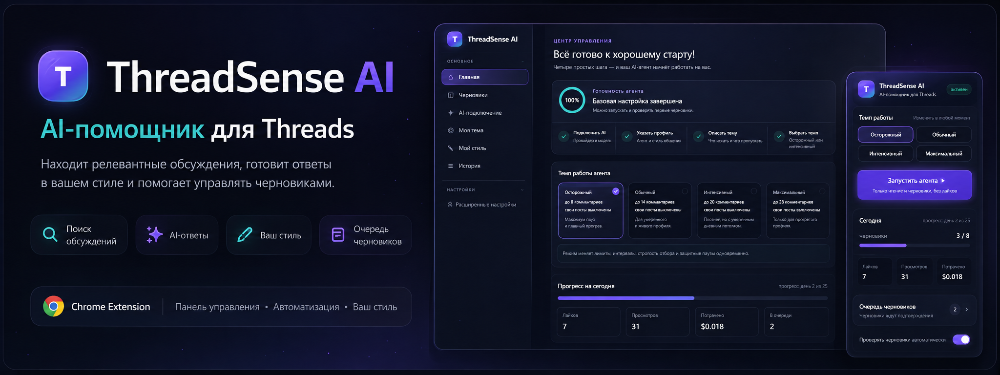
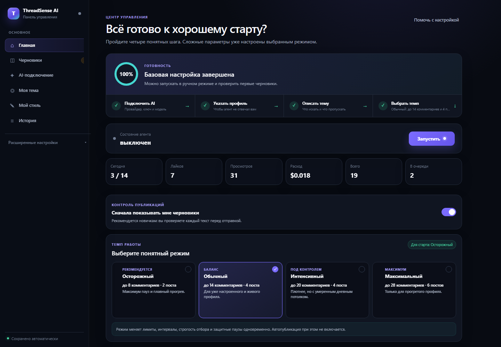
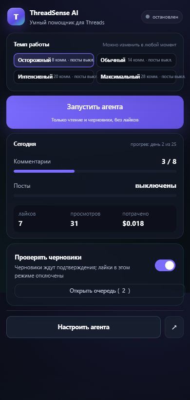

<div align="center">
  
</div>

# ThreadSense AI

> [!CAUTION]
> ## ⚠️ Важное предупреждение: Meta, автоматизация и риск блокировки
>
> **Автор не связан с Meta, Instagram или Threads и не несёт ответственности за блокировку аккаунта, потерю данных, расходы на AI API или любой другой ущерб.** Автоматизированный доступ и сбор данных в продуктах Meta запрещены без предварительного явного письменного разрешения Meta. Условия Threads отдельно запрещают использовать роботов, скрейперы и другие автоматические средства для доступа, извлечения или сбора информации. Использование расширения может привести к ограничениям, временной приостановке или безвозвратной блокировке аккаунта.
>
> Устанавливая ThreadSense AI, вы принимаете весь риск на себя. Используйте только собственный аккаунт и данные, не обходите защитные механизмы и перед каждым запуском проверяйте актуальные [Условия Threads](https://help.instagram.com/769983657850450), [Условия Instagram](https://www.facebook.com/help/instagram/581066165581870) и [Условия Meta об автоматизированном сборе данных](https://www.facebook.com/legal/automated_data_collection_terms). Настройки темпа и пауз **не делают автоматизацию разрешённой или «необнаружимой»**.

<div align="center">

### AI-помощник для поиска обсуждений, подготовки ответов и управления черновиками в Threads


[](https://github.com/sany86russ/ThreadSense-AI/stargazers)

**Находит релевантные ветки → оценивает их → готовит текст в вашем стиле → отдаёт результат на ручную проверку.**

[⭐ GitHub](https://github.com/sany86russ/ThreadSense-AI) · [🚀 Быстрый старт](#-быстрый-старт) · [🧭 Интерфейс](#-интерфейс) · [⚙️ Все настройки](#️-все-настройки) · [🤖 AI-провайдеры](#-ai-провайдеры) · [❓ FAQ](#-частые-вопросы) · [💜 Поддержать автора](#-поддержать-автора)

**Русский** · [English](README.en.md)

</div>

---

## 📑 Содержание

- [Что это такое](#-что-это-такое)
- [Возможности](#-возможности)
- [Интерфейс](#-интерфейс)
- [Требования](#-требования)
- [Установка](#-установка)
- [Быстрый старт](#-быстрый-старт)
- [Безопасные настройки по умолчанию](#-безопасные-настройки-по-умолчанию)
- [Режимы работы](#-режимы-работы)
- [AI-провайдеры](#-ai-провайдеры)
- [Все настройки](#️-все-настройки)
- [Как работает агент](#-как-работает-агент)
- [Данные, ключи и приватность](#-данные-ключи-и-приватность)
- [Разрешения Chrome](#-разрешения-chrome)
- [Диагностика и решение проблем](#-диагностика-и-решение-проблем)
- [Разработка и тесты](#-разработка-и-тесты)
- [Структура проекта](#-структура-проекта)
- [Ограничения](#-ограничения)
- [Частые вопросы](#-частые-вопросы)
- [Поддержать автора](#-поддержать-автора)
- [Участие в разработке](#-участие-в-разработке)
- [Дисклеймер и лицензия](#️-дисклеймер-и-лицензия)

---

## 🧠 Что это такое

**ThreadSense AI** — открытое расширение Chrome для работы с видимым веб-интерфейсом Threads. Оно помогает находить обсуждения по вашей теме, фильтровать и ранжировать посты, анализировать контекст ветки, готовить комментарии или собственные публикации с выбранной AI-моделью и складывать результат в очередь на подтверждение.

Проект рассчитан не только на технических пользователей. Первый запуск разбит на четыре понятных шага, сложные параметры спрятаны в расширенный режим, а настройки сохраняются автоматически.

> [!IMPORTANT]
> ThreadSense AI **не использует официальный Threads API** и не является одобренным Meta приложением. Расширение читает доступный вам DOM открытой вкладки и взаимодействует с обычными полями страницы. Это техническое описание, а не подтверждение допустимости такого использования.

## ✨ Возможности

| | Что умеет |
|---|---|
| 🎯 **Поиск по вашей теме** | Ниша, языки, ключевые слова, стоп-слова, поисковые фразы, темы, конкретные и заблокированные авторы. |
| 🧮 **Многоступенчатый отбор** | Бесплатные локальные фильтры, импульс поста, скоринг релевантности, свежести, вовлечения, возможности и риска. |
| ✦ **Подключаемый AI** | OpenAI, Anthropic, DeepSeek, Kimi, Gemini, xAI, Mistral, Groq, OpenRouter, Together AI и свой OpenAI-совместимый API. |
| 🔎 **Модели по ключу** | Кнопка проверки соединения получает доступные модели непосредственно у выбранного провайдера. |
| ✍️ **Ваш стиль** | Ручное описание манеры, примеры, любимые слова и эмодзи, запрещённые обороты или обучение по собственному профилю. |
| 🧩 **Свои промпты** | Отдельные инструкции для релевантности, анализа ветки, комментариев, ответов читателям и собственных постов. |
| 🗂 **Очередь черновиков** | Просмотр, подтверждение, отклонение и история обработанных текстов до публикации. |
| 🛡 **Защитные ограничения** | Дневные и часовые лимиты, прогрев, паузы, cooldown авторов, circuit breaker, повторная проверка и аварийная остановка. |
| 📊 **Понятный контроль** | Статус, прогресс дня, лайки, просмотры, ориентировочные расходы, история и причина остановки. |
| 🧰 **Диагностика** | Проверка DOM-селекторов, подсветка найденных постов, пробная генерация без публикации, импорт и экспорт настроек. |

## 🧭 Интерфейс

### Центр управления и настройки

Главная страница показывает процент готовности, четыре обязательных шага, состояние агента, дневной прогресс и рекомендуемый режим. Основные настройки доступны сразу; технические параметры вынесены в раскрываемый раздел.



### Компактное окно расширения

Popup предназначен для ежедневной работы: запуск и остановка, выбор темпа, дневные лимиты, очередь черновиков, последние события и быстрый переход в настройки.

<p align="center">
  
</p>

## 📋 Требования

- Google Chrome **116+** или совместимый Chromium-браузер с Manifest V3;
- активный аккаунт Threads и открытая вкладка `threads.com` или `threads.net`;
- API-ключ хотя бы одного поддерживаемого AI-провайдера;
- для разработки и тестов — Node.js **20+**;
- понимание и самостоятельное принятие рисков, описанных в предупреждении в начале README.

## 📥 Установка

### Готовая сборка — рекомендуется

1. Скачайте [`ThreadSense-AI-v2.2.0-unpacked.zip`](https://github.com/sany86russ/ThreadSense-AI/releases/download/v2.2.0/ThreadSense-AI-v2.2.0-unpacked.zip) из раздела **Assets** [последнего релиза](https://github.com/sany86russ/ThreadSense-AI/releases/latest).
2. Распакуйте ZIP в постоянную папку. Внутри будет готовый каталог `ThreadSense-AI-v2.2.0` с файлом `manifest.json`.
3. Откройте `chrome://extensions`.
4. Включите **Режим разработчика**.
5. Нажмите **Загрузить распакованное расширение**.
6. Выберите распакованную папку `ThreadSense-AI-v2.2.0` — именно ту, внутри которой лежит `manifest.json`.
7. Закрепите ThreadSense AI на панели браузера.

> [!IMPORTANT]
> Chrome загружает **папку**, а не ZIP-файл. Сначала обязательно распакуйте архив. Не перемещайте и не удаляйте выбранную папку после подключения расширения.

### Установка из исходников

Разработчики могут клонировать репозиторий и выбрать папку `extension`. После получения обновлений нажмите **Обновить** на карточке расширения в `chrome://extensions`.

```powershell
git clone https://github.com/sany86russ/ThreadSense-AI.git
cd ThreadSense-AI
```

> [!NOTE]
> Готовый ZIP содержит только файлы расширения из тега `v2.2.0`: без тестов, Git-истории, локальных настроек и ключей. Это распакованное Manifest V3-расширение, а не `.crx`; Chrome может показывать стандартное предупреждение о режиме разработчика.

## 🚀 Быстрый старт

### 1. Скачайте и подключите готовое расширение

1. Откройте [последний релиз ThreadSense AI](https://github.com/sany86russ/ThreadSense-AI/releases/latest).
2. В блоке **Assets** скачайте **`ThreadSense-AI-v2.2.0-unpacked.zip`**.
3. Распакуйте архив и запомните расположение папки `ThreadSense-AI-v2.2.0`.
4. Вставьте `chrome://extensions` в адресную строку Google Chrome.
5. Включите **Режим разработчика** в правом верхнем углу.
6. Нажмите **Загрузить распакованное расширение** и выберите папку `ThreadSense-AI-v2.2.0` с `manifest.json` внутри.
7. Нажмите значок пазла в панели Chrome и закрепите **ThreadSense AI**.

### 2. Подключите AI

Откройте **Настройки → AI-подключение**, выберите провайдера, вставьте собственный API-ключ и нажмите **Проверить**. После успешной проверки назначьте модели для:

- оценки постов;
- написания комментариев;
- разбора вашего стиля.

Если не знаете, что выбрать, используйте одну доступную недорогую модель во всех трёх полях и оставьте остальные параметры без изменений.

### 3. Укажите профиль и тему

Во вкладке **Моя тема**:

1. введите свой Threads-хэндл без `@` или нажмите **Определить**;
2. обычными словами опишите, о чём вы пишете и какие обсуждения ищете;
3. добавьте языки и несколько поисковых фраз;
4. при необходимости задайте стоп-слова и авторов в игноре.

Пустых ключа, хэндла или описания темы достаточно, чтобы мастер намеренно не разрешил запуск.

### 4. Настройте стиль

Откройте **Мой стиль** и выберите один из вариантов:

- нажмите **Обучить**, пока открыта страница вашего Threads-профиля;
- вручную опишите тон и характер речи;
- добавьте несколько настоящих примеров своих комментариев.

### 5. Выберите осторожный режим

Оставьте пресет **Осторожный** и переключатель **Сначала показывать мне черновики** включённым. Откройте Threads, нажмите **Запустить** и проверяйте каждый результат в очереди.

> [!TIP]
> До реальной работы откройте **Расширенные настройки → Диагностика**, запустите проверку селекторов и затем пробную генерацию. Пробная генерация расходует токены, но ничего не публикует.

## 🔒 Безопасные настройки по умолчанию

Новая установка специально ничего не запускает сама:

- агент выключен;
- автопубликация выключена;
- собственные публикации выключены;
- если собственные публикации включить, режим `draftsOnly` изначально оставляет их черновиками;
- выбран самый медленный пресет **Осторожный**;
- AI-соединение считается неподтверждённым до реального тестового запроса;
- ключ, хэндл и ниша пусты;
- импорт профиля останавливает агент и снова требует пройти проверку готовности;
- обновление со старой версии сбрасывает опасные режимы и повторно показывает мастер.

Это снижает риск случайного запуска, но **не отменяет запреты Meta и не гарантирует сохранность аккаунта**.

## 🎚 Режимы работы

Пресет атомарно меняет лимиты, интервалы, ширину отбора и защитные паузы. Он **не включает автопубликацию и не включает собственные посты**.

| Режим | Комментарии в день | Собственные посты в день* | Для кого |
|---|---:|---:|---|
| **Осторожный** | до 8 | до 2 | Первый запуск, длинные паузы и плавный прогрев. |
| **Обычный** | до 14 | до 4 | Уже настроенный живой профиль. |
| **Интенсивный** | до 20 | до 4 | Прогретый профиль под постоянным ручным наблюдением. |
| **Максимальный** | до 28 | до 6 | Самый агрессивный профиль; риск ограничений особенно высок. |

\* Лимит собственных постов применяется только после отдельного включения функции. Ни один режим не является «безопасным от бана».

## 🤖 AI-провайдеры

| Провайдер | Протокол | Адрес по умолчанию | Получение списка моделей |
|---|---|---|---|
| OpenAI | Chat Completions | `https://api.openai.com/v1` | Да |
| Anthropic | Messages API | `https://api.anthropic.com/v1` | Да |
| DeepSeek | OpenAI-compatible | `https://api.deepseek.com/v1` | Да |
| Kimi / Moonshot AI | OpenAI-compatible | `https://api.moonshot.ai/v1` | Да |
| Google Gemini | Gemini API | `https://generativelanguage.googleapis.com/v1beta` | Да |
| xAI / Grok | OpenAI-compatible | `https://api.x.ai/v1` | Да |
| Mistral AI | OpenAI-compatible | `https://api.mistral.ai/v1` | Да |
| Groq | OpenAI-compatible | `https://api.groq.com/openai/v1` | Да |
| OpenRouter | OpenAI-compatible | `https://openrouter.ai/api/v1` | Да |
| Together AI | OpenAI-compatible | `https://api.together.xyz/v1` | Да |
| Свой шлюз | OpenAI-compatible | задаёт пользователь | Да, если шлюз реализует `/models` |

ThreadSense AI использует модели, реально доступные введённому ключу. Список и цены у провайдеров меняются, поэтому README не рекомендует конкретное имя модели как постоянное.

Для удалённого пользовательского шлюза разрешён только **HTTPS**. Обычный HTTP допускается исключительно для `localhost`, `127.0.0.1` и `[::1]`. Адрес с логином или паролем в URL отклоняется.

### Как разделить модели

- **Оценка постов** — быстрая и недорогая модель для массовой фильтрации.
- **Написание комментария** — более качественная модель для финального текста.
- **Разбор стиля** — модель с хорошим пониманием длинного контекста.
- **Запасные модели** — цепочка на случай временной недоступности основной.

Дневной бюджет — локальный предохранитель по расчётной стоимости, а не биллинг провайдера. Для неизвестных моделей заполните стоимость входных, кешированных и выходных токенов вручную.

## ⚙️ Все настройки

### Основные разделы

| Раздел | Что настраивается |
|---|---|
| **Главная** | Готовность, запуск, ручная проверка, пресет, прогноз и статистика. |
| **Черновики** | Ожидающие подтверждения и обработанные элементы очереди. |
| **AI-подключение** | Провайдер, ключ, API URL, модели, два прохода, reasoning, sampling, повторы, fallback, бюджет, цены и собственные промпты. |
| **Моя тема** | Хэндл, описание ниши, языки, ключевые и стоп-слова, источники, поисковые фразы, темы и авторы. |
| **Мой стиль** | Обучение по профилю, описание манеры, примеры, слова-паразиты, эмодзи, запрещённые фразы и длина текста. |
| **История** | Публикации, черновики, пропуски, защитные события и ошибки. |

### AI и собственные промпты

Режим **Добавить** дополняет встроенную системную инструкцию вашим текстом. Режим **Заменить** использует вашу инструкцию вместо тематической части для выбранного этапа. Встроенные проверки формата и безопасности остаются активными.

Отдельные поля есть для:

- первичного отбора постов;
- анализа всей ветки;
- комментариев;
- ответов читателям под своими публикациями;
- собственных постов и цепочек.

### Источники и публикации

Агент может брать кандидатов из главной ленты, поиска, тем и списка авторов. Дополнительный режим готовит разборы по GitHub и реестру MCP. Собственные публикации включаются отдельно: задаются дневной максимум, день старта, окно времени, интервал, режим «только черновики», локальная карточка, тема Threads и дополнительный источник материалов.

Токен дополнительного источника хранится локально и, как API-ключ, не попадает в экспорт.

### Расширенные разделы

| Раздел | Назначение |
|---|---|
| **Фильтры** | Длина, возраст, медиа и минимальные метрики до обращения к AI. |
| **Импульс постов** | Пороги свежего старта, сильной реакции, крупного поста и затухания. |
| **Отбор веток** | Веса релевантности, свежести, вовлечения, возможности, автора, импульса и риска. |
| **Гуманизация** | Локальная постобработка пунктуации, регистра, клише, эмодзи и опечаток с предпросмотром. |
| **Углы захода** | Вероятности форматов ответа и защита от повторения одного приёма. |
| **Тайминги** | Длительность сессий, случайные интервалы, перерывы и почасовой профиль активности. |
| **Лимиты** | Дневные/часовые потолки, прогрев, cooldown авторов и соотношение просмотров к действиям. |
| **Набор текста** | Скорость, ритм и поведение ввода в редакторе Threads. |
| **Безопасность** | Circuit breaker, пауза при блоках, повторные проверки, исчезнувшие публикации и регенерация. |
| **Диагностика** | Селекторы, подсветка, dry run, импорт/экспорт, сброс настроек и счётчиков. |

> [!WARNING]
> «Гуманизация», случайные интервалы, медленный ввод и лимиты не являются обходом правил и не гарантируют незаметность. Эти параметры существуют для качества текста и управляемого UX, а не для обещания защиты от систем Meta.

## 🔄 Как работает агент

```mermaid
flowchart LR
    A["Открытая вкладка Threads"] --> B["Чтение видимого DOM"]
    B --> C["Локальные фильтры и импульс"]
    C --> D["AI-оценка релевантности"]
    D --> E["Анализ ветки и генерация"]
    E --> F["Проверки длины, повторов и риска"]
    F --> G["Очередь черновиков"]
    G --> H["Ручное подтверждение пользователя"]
    H --> I["Ввод в открытой вкладке Threads"]
```



Service worker хранит расписание и состояние, content script читает страницу и работает с редактором Threads, а UI управляет конфигурацией и очередью. Если вкладка Threads закрыта, публикация из очереди невозможна.

## 🔐 Данные, ключи и приватность

- Настройки, очередь, состояние и журналы хранятся локально через `chrome.storage.local`.
- API-ключ отправляется только выбранному AI API при проверке и генерации.
- API-ключ и токен источника материалов исключаются из JSON-экспорта.
- Проект не содержит встроенных ключей, аккаунтов, cookies или персональной ниши автора.
- Пользовательский удалённый API должен использовать HTTPS.
- Содержимое поста и контекст ветки передаются выбранному AI-провайдеру для анализа или генерации.
- ThreadSense AI не может управлять политикой хранения данных выбранного провайдера — ознакомьтесь с его условиями отдельно.

Используйте отдельный API-ключ с минимально необходимым лимитом расходов. Никогда не публикуйте в issue дамп `chrome.storage`, cookies, экспорт профиля Chrome или журналы с приватными текстами. Подробнее: [PRIVACY.md](PRIVACY.md) и [SECURITY.md](SECURITY.md).

## 🧩 Разрешения Chrome

| Разрешение | Зачем нужно |
|---|---|
| `storage` | Сохранение настроек, очереди, истории и состояния. |
| `alarms` | Планирование сессий и фоновых проверок. |
| `tabs` | Поиск и открытие вкладки Threads. |
| `notifications` | Уведомления об остановках и важных событиях. |
| `scripting` | Диагностика и работа во вкладке Threads. |
| Host permissions | Threads, выбранные AI API и явно поддержанные источники материалов. |
| Optional host permissions | Пользовательский HTTPS-шлюз или локальный API; доступ запрашивается отдельно. |

Публичная сборка не запрашивает разрешение Chrome `debugger`.

## 🩺 Диагностика и решение проблем

### Агент не запускается

Проверьте четыре пункта на Главной: успешное AI-подключение, свой хэндл, описание темы и выбранный режим. Затем откройте вкладку Threads и обновите страницу после установки расширения.

### Ключ не проходит проверку

- убедитесь, что выбран правильный провайдер;
- проверьте баланс, права ключа и региональные ограничения;
- для своего шлюза проверьте HTTPS и совместимость `/models` и Chat Completions;
- не вставляйте полный `.../chat/completions` — укажите базовый URL API.

### Модели не появились

Некоторые шлюзы не возвращают список моделей. Для встроенных провайдеров повторите проверку соединения; для своего шлюза реализуйте совместимый endpoint `/models`.

### Агент перестал видеть посты

Threads регулярно меняет DOM. Откройте **Диагностика → Проверка селекторов**, запустите инспектор и приложите обезличенный результат к issue. Не прикладывайте HTML страницы целиком или cookies.

### Черновик не публикуется

Должна быть открыта активная вкладка Threads с доступным редактором ответа. Проверьте, что аккаунт не показывает challenge, предупреждение или ограничение действий.

### Как полностью начать заново

В **Диагностике** отдельно доступны **Сбросить настройки** и **Сбросить счётчики**. Первый возвращает безопасную публичную конфигурацию; второй очищает статистику, cooldown и прогрев, не меняя настройки.

## 🧪 Разработка и тесты

У расширения нет внешних npm-зависимостей. Нужен Node.js 20+.

```powershell
npm test
npm run test:syntax
npm run test:math
npm run test:providers
```

Полный `npm test` выполняет:

- синтаксическую проверку файлов расширения;
- математические и регрессионные проверки логики;
- контрактные тесты AI-провайдеров на локальных ответах-заглушках;
- контроль manifest, версии, миграций и отсутствия секретов.

Тестам не нужны настоящий Threads-аккаунт или API-ключ, и они не расходуют токены. Ручные сценарии и границы проверки описаны в [docs/TESTING.md](docs/TESTING.md), итоговая матрица готовности — в [docs/RELEASE-READINESS.md](docs/RELEASE-READINESS.md).

## 🗃 Структура проекта

```text
extension/
├── manifest.json          # Manifest V3 и разрешения
└── src/
    ├── common/            # схема, дефолты, миграции, провайдеры
    ├── bg/                # service worker, AI, скоринг, очередь
    ├── content/           # DOM Threads, инспектор, ввод и публикация
    └── ui/                # popup, настройки и статус
docs/                      # скриншоты, тестирование, готовность релиза
test/                      # синтаксис, математика, provider contracts
PRIVACY.md                 # модель данных и приватность
SECURITY.md                # безопасное сообщение об уязвимостях
```

## 🚧 Ограничения

- DOM и поведение Threads меняются без предупреждения; селекторы могут перестать работать.
- Расширение зависит от открытой авторизованной вкладки и состояния аккаунта.
- Ответ AI может быть неточным, неуместным или нарушать правила; проверяйте каждый черновик.
- Расчёт расходов ориентировочный и не заменяет биллинг провайдера.
- Публичные тесты не могут доказать допустимость автоматизации или отсутствие риска блокировки.
- Поддержка провайдера означает совместимость протокола, а не гарантию доступности любой модели или страны.
- Интерфейс расширения в текущей версии русскоязычный; английская README предназначена для документации проекта.
- Проект не предназначен для массового сбора данных, слежения, продажи наборов данных, спама или обхода ограничений Meta.

## ❓ Частые вопросы

<details>
<summary><strong>Это защищает аккаунт от блокировки?</strong></summary>

Нет. Ни один пресет, лимит или алгоритм пауз не даёт такой гарантии. Meta может ограничить или заблокировать аккаунт, а автоматизированный сбор без разрешения запрещён её условиями.
</details>

<details>
<summary><strong>Можно работать только с черновиками?</strong></summary>

Да. Это рекомендуемый режим: AI готовит текст, а решение о публикации принимает пользователь. Но автоматизированное чтение страницы само по себе также может подпадать под правила Meta.
</details>

<details>
<summary><strong>Нужен OpenAI?</strong></summary>

Нет. Доступны Anthropic, DeepSeek, Kimi, Gemini, xAI, Mistral, Groq, OpenRouter, Together AI и совместимые шлюзы.
</details>

<details>
<summary><strong>Куда попадает мой API-ключ?</strong></summary>

Он хранится локально в `chrome.storage.local` и отправляется выбранному API. В экспорт настроек ключ не включается.
</details>

<details>
<summary><strong>Можно импортировать готовую нишу автора?</strong></summary>

Нет — и это намеренно. Публичная версия не содержит ниши, аккаунта, ключей или персональных промптов автора. Каждый пользователь настраивает тему и стиль сам.
</details>

<details>
<summary><strong>Почему нет сборки из Chrome Web Store?</strong></summary>

Сейчас проект распространяется как открытый исходный код и загружается в режиме разработчика. Проверяйте изменения перед обновлением.
</details>

## 💜 Поддержать автора

ThreadSense AI распространяется бесплатно по лицензии MIT. Если проект оказался полезен, можно поддержать дальнейшую разработку криптовалютой. Спасибо! 🙌

<table>
<tr>
<th align="center" width="50%">₿ Bitcoin (BTC)</th>
<th align="center" width="50%">₮ Tether (USDT)</th>
</tr>
<tr>
<td align="center">
<br/>
Сеть: <strong>Bitcoin</strong>
</td>
<td align="center">
<br/>
Сеть: <strong>Tron (TRC20)</strong>
</td>
</tr>
<tr>
<td align="center"><code>1GFcHvGPchDf6fgAqqtyZrEkFbVcrnWFgQ</code></td>
<td align="center"><code>TEByALUzbYKWCYvyKPiAKrErs8ba6gc4Bo</code></td>
</tr>
</table>

> [!WARNING]
> Отправляйте средства **строго в указанной сети**: BTC — только Bitcoin, USDT — только Tron (TRC20). Перевод в другой сети может привести к безвозвратной потере средств. Перед отправкой обязательно сверьте адрес вручную.

## 🤝 Участие в разработке

Pull request приветствуются, если изменение:

- не добавляет секреты, cookies, обход challenge или скрытый сбор данных;
- сохраняет безопасные дефолты и ручное подтверждение;
- сопровождается тестом для новой логики;
- обновляет обе README при изменении пользовательского поведения;
- не включает реальные пользовательские тексты или идентификаторы в fixtures.

Об ошибках сообщайте через [GitHub Issues](https://github.com/sany86russ/ThreadSense-AI/issues) с шагами воспроизведения и обезличенным результатом диагностики. Уязвимости не публикуйте открыто — следуйте [SECURITY.md](SECURITY.md).

## ⚖️ Дисклеймер и лицензия

Проект предоставляется **«как есть»**, без гарантий работоспособности, соответствия правилам платформы, пригодности для конкретной цели или сохранности аккаунта. Автор и участники проекта не отвечают за блокировки, потерю доступа, данные, публикации, расходы, упущенную выгоду или претензии третьих лиц.

Вы самостоятельно отвечаете за соблюдение условий Meta, Threads, Instagram, выбранного AI-провайдера и применимого законодательства. Наличие исходного кода, ручной очереди или технических ограничителей не является разрешением Meta.

Код распространяется по лицензии [MIT](LICENSE).
